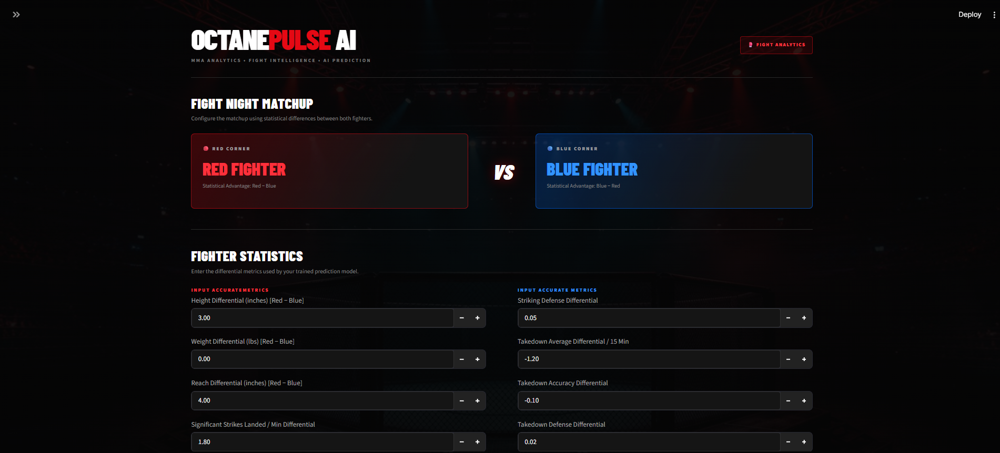
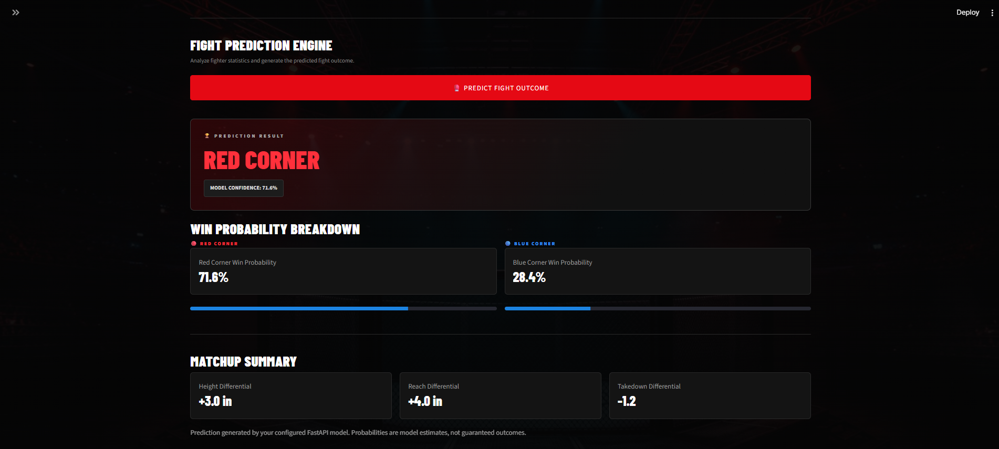

# 🥊 OctanePulse AI: Real-Time UFC Fight Outcome & Analytics Platform

<p align="center">
  
  
  
  
</p>

## 📌 Overview

**OctanePulse AI** is an end-to-end Machine Learning and Full-Stack Web Application designed to predict UFC fight outcomes using historical bout statistics, fighter performance metrics, striking efficiency, grappling data, and physical attributes.

The project demonstrates:

- Data Engineering & ETL Pipelines
- Machine Learning Model Development
- REST API Design
- Cloud Deployment
- Interactive Data Visualization
- Production-Oriented Full-Stack Architecture

---

## 🎯 Problem Statement

Predicting combat sports outcomes is inherently complex due to the interaction of numerous factors such as:

- Reach advantage
- Height differential
- Significant strike accuracy
- Takedown efficiency
- Defensive capabilities
- Historical performance trends

OctanePulse AI leverages historical UFC datasets and machine learning algorithms to generate probabilistic fight predictions and matchup analytics.

---

# 🏗️ System Architecture

```text
┌─────────────────────────────┐
│ UFC Historical Datasets     │
└──────────────┬──────────────┘
               │
               ▼
┌─────────────────────────────┐
│ Pandas ETL Pipeline         │
│ Data Cleaning & Validation  │
└──────────────┬──────────────┘
               │
               ▼
┌─────────────────────────────┐
│ Feature Engineering         │
│ Reach Differential          │
│ Height Differential         │
│ Strike Efficiency           │
│ Grappling Metrics           │
└──────────────┬──────────────┘
               │
               ▼
┌─────────────────────────────┐
│ Random Forest Classifier    │
│ Model Training & Evaluation │
└──────────────┬──────────────┘
               │
               ▼
┌─────────────────────────────┐
│ Serialized Model (.joblib)  │
└──────────────┬──────────────┘
               │
               ▼
┌─────────────────────────────┐
│ FastAPI Backend             │
│ Public REST API             │
└──────────────┬──────────────┘
               │
               ▼
┌─────────────────────────────┐
│ Streamlit Dashboard         │
│ Interactive Predictions     │
└─────────────────────────────┘
```

---

# ⚙️ Technology Stack

## Data Processing & ETL

- Python
- Pandas
- NumPy

## Machine Learning

- Scikit-Learn
- Random Forest Classifier
- Feature Engineering Pipeline
- Model Serialization (Joblib)

## Backend Development

- FastAPI
- Uvicorn
- Pydantic
- RESTful API Architecture

## Frontend & Analytics

- Streamlit
- Plotly
- Requests

## Cloud Deployment

- Render
- Streamlit Community Cloud
- GitHub Actions *(Future Enhancement)*

---

# 🚀 Key Features

### ✅ Advanced Feature Engineering

Transforms raw fight data into predictive metrics including:

- Reach Differential
- Height Differential
- Weight Differential
- Significant Strike Efficiency
- Strike Absorption Rate
- Takedown Accuracy
- Defensive Statistics

### ✅ Machine Learning Prediction Engine

Uses a trained Random Forest Classifier to generate:

- Winner Prediction
- Probability Scores
- Matchup Confidence Levels

### ✅ High-Performance REST API

FastAPI backend provides:

- JSON-based requests
- Input validation with Pydantic
- Probability distribution outputs
- Low-latency inference

### ✅ Interactive Dashboard

Streamlit interface enables:

- Fighter matchup simulation
- Probability visualization
- Model confidence analysis
- User-friendly sports analytics experience

### ✅ Cloud Deployment

Production-ready solution consisting of:

- FastAPI API deployed on Render
- Streamlit Frontend deployed on Streamlit Cloud

---

# 📊 Example API Request

```json
{
  "height_diff": 5,
  "reach_diff": 4,
  "sig_strike_diff": 1.2,
  "takedown_accuracy_diff": 18
}
```

### Response

```json
{
  "predicted_winner": "Red Corner",
  "win_probability": 0.73
}
```

---

# 📂 Project Structure

```text
octanepulse-ai/
│
├── api/
│   ├── main.py
│   ├── model_loader.py
│   └── schemas.py
│
├── app/
│   └── streamlit_app.py
│
├── data/
│   ├── raw/
│   └── processed/
│
├── models/
│   └── fight_predictor.joblib
│
├── notebooks/
│   └── experimentation.ipynb
│
├── requirements.txt
│
└── README.md
```

---

# 🛠️ Local Installation

## 1️⃣ Clone Repository

```bash
git clone https://github.com/your-username/octanepulse-ai.git

cd octanepulse-ai
```

## 2️⃣ Create Virtual Environment

### Linux / macOS

```bash
python -m venv venv

source venv/bin/activate
```

### Windows

```bash
venv\Scripts\activate
```

## 3️⃣ Install Dependencies

```bash
pip install -r requirements.txt
```

## 4️⃣ Start FastAPI Backend

```bash
uvicorn api.main:app --reload
```

Open API Documentation:

```text
http://localhost:8000/docs
```

## 5️⃣ Launch Streamlit Dashboard

Open another terminal and run:

```bash
streamlit run app/streamlit_app.py
```

---

# 📈 Future Enhancements

- XGBoost & LightGBM Model Comparison
- Fighter Trend Analysis
- Live UFC Event Predictions
- Docker Containerization
- CI/CD Pipeline Automation
- User Authentication
- PostgreSQL Database Integration
- Real-Time Sports Data APIs

---

# 🧪 Machine Learning Workflow

```text
Data Collection
      ↓
Data Cleaning
      ↓
Feature Engineering
      ↓
Model Training
      ↓
Cross Validation
      ↓
Model Serialization
      ↓
API Deployment
      ↓
Interactive Dashboard
```

---


# 🏆 What This Project Demonstrates

✅ Machine Learning Engineering

✅ Feature Engineering

✅ API Development

✅ Cloud Deployment

✅ Data Analytics

✅ Full-Stack Development

✅ Production-Oriented Architecture

✅ End-to-End Software Delivery

---

# 📸 Screenshots

## Dashboard





## Prediction Output





---

# 🤝 Contributing

Contributions, issues, and feature requests are welcome.

1. Fork the repository
2. Create a feature branch

```bash
git checkout -b feature/new-feature
```

3. Commit your changes

```bash
git commit -m "Add new feature"
```

4. Push to GitHub

```bash
git push origin feature/new-feature
```

5. Open a Pull Request

---

# 📄 License

This project is licensed under the MIT License. See the `LICENSE` file for details.

---

# 👨‍💻 Author

**Mohammed Abu Hurer**

- GitHub: https://github.com/your-username
- LinkedIn: https://linkedin.com/in/your-profile

---

## ⭐ Support

If you found this project useful, please consider:

- ⭐ Starring the repository
- 🍴 Forking the project
- 💼 Connecting on LinkedIn
- 🚀 Sharing with fellow developers

---

### Built with ❤️ using Python, FastAPI, Machine Learning, and Streamlit
